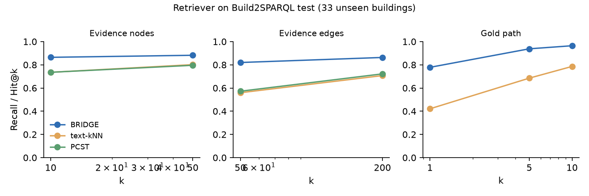
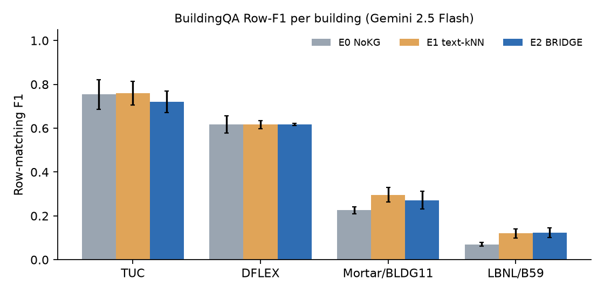

# BRIDGE: first autonomous run — training on Build2SPARQL, evaluation on BuildingQA

*Run window 2026-11-01 13:46 → 2026-11-02 ~18:30 PST. Code: `bridge/` (retriever and evaluation) and `BKGQA/` (ontology-agnostic BrickQA port). All numbers: `reports/bridge_results.json`. Logs and decisions: `runs/PROGRESS.md`, `runs/DECISIONS.md`.*

## 1. Summary

- **The retriever works and transfers to unseen buildings.** On the Build2SPARQL test split (33 unseen buildings, 5,000 questions), BRIDGE beats text-kNN on every aggregate metric:

  | Metric | BRIDGE | text-kNN |
  |---|---:|---:|
  | Gold-path Hit@1 | **0.778** | 0.421 |
  | Gold-path Hit@10 | **0.964** | 0.786 |
  | Evidence-edge Recall@50 | **0.820** | 0.559 |
  | Answer-variable F1 | **0.757** | 0.364 |

  223P is the weak stratum (node Recall@10 0.575 vs kNN 0.654).
- **On BuildingQA, the retrieval gain does not carry over to the end-to-end answer.** Gemini 2.5 Flash, 3 runs each, 4 buildings, 188 questions, question-weighted Row-F1:

  | Configuration | Row-F1 |
  |---|---:|
  | E0 (no context) | 0.347 ± 0.016 |
  | E1 (text-kNN context) | **0.389 ± 0.008** |
  | E2 (BRIDGE context) | 0.373 ± 0.019 |

  Both context types help over no context; BRIDGE does **not** beat the non-learned baseline.
- **Removing BrickQA's Brick-specific parts (BKGQA) is the largest single gain in this run.** On a 60-question dev set drawn from Build2SPARQL test buildings, Row-F1 went from 0.083 (BrickQA) to 0.289 (BKGQA), both with no context. On BuildingQA (no context), it went from 0.307 to 0.347. B59 (223P) moved off 0, but only to 0.07–0.12.
- **We are well below the published BSchema result.** 4-building question-weighted Row-F1 is 0.373–0.389, against BSchema's 0.595. The gap is concentrated in Mortar/BLDG11 (0.27–0.30 vs 0.63) and LBNL/B59 (0.12 vs 0.30). The dominant failure is **arity / projection mismatch**: 87 of 130 failed E2 questions in run 1. The retriever rarely causes the failure.
- **Cost:**

  | Resource | Used | Cap |
  |---|---:|---:|
  | GPU | 4.1 A100 GPU-hours | 15 |
  | Gemini 2.5 Flash | 112.8M input + 15.5M output tokens, **$26.2** at the prescribed estimate prices | $40 |
  | Wall clock | about 28.5 h | 30 h |

## 2. Setup

**Data coverage.** All 196 split buildings were resolved; 0 are missing.
- Brick example graphs were taken from Brick tag v1.4.4 (`controller` from v1.5.0-rc1), because `master` has moved to Brick 1.5/REC and its graphs no longer match the queries.
- IBAL was mapped to NIST-IBAL.ttl.
- For the 16 open223 buildings we used the "compiled" model wherever it executes more gold queries.

Gold queries executed (pyoxigraph, ABox + Brick 1.4.3 / 223P TBox, 60 s timeout, 0 timeouts):

| Split | Executed | Kept (cap 60 per building) |
|---|---:|---:|
| Train | 4,669 / 4,670 | 4,520 |
| Val | 256 / 256 | 242 |
| Test | 1,005 / 1,012 | 1,000 |

This gives 28,810 question samples, of which 28,140 carry a single-chain gold class path. All 27 BuildingQA gold queries execute; the Mortar ones need TTL-declared prefixes prepended. BuildingQA graphs were used only at inference time.

**Model.** The model follows the spec. Trained from scratch; no ULTRA checkpoint.
- **Soft seeding:** top-32 nodes, learnable τ initialised at 0.1.
- **Relation GNN:** ULTRA-style, 6 layers, 4 meta-relations, relations initialised from their text, with no per-relation table.
- **Entity GNN:** NBFNet-style, 6 layers, d = 64.
- **Heads:** node, edge (3 hops around the top-64 nodes), and answer variable.
- **Loss:** BCE_node + BCE_edge + 0.5·InfoNCE_path + 0.5·BCE_ans.
- **Optimisation:** AdamW, lr 5e-4, batch of 16 questions per building, seed 0.
- **One addition:** the node and answer heads also see projected node-text features.
- **Training:** early stopping on val path Hit@10 picked epoch 10 of 13 (val Hit@10 0.984), in 46 min on one A100.

**Agent.** BrickQA is Brick-only: E0 used `brick:` terms in 36/46 B59 queries. So E0/E1/E2 were re-run with **BKGQA** (`BKGQA/`, an ontology-agnostic port of BrickQA; `BrickQA/` itself was not modified). BKGQA keeps the same pipeline: decomposer → ReAct loop with graph tools and execution feedback → SPARQL fixer → stop. It replaces the Brick-only parts:
- the prompts, the class table and `BRICK_PREFIXES` give way to per-graph ontology detection, the graph's own prefixes, standards-based pattern hints, and a summary of the vocabulary that actually occurs in the graph;
- the tools become ontology-neutral.

Context blocks (E1, E2: ~2k-token budget) go into the same prompt slot as BrickQA's `--schema-in-prompt`.

Per question:
- each question runs in a fresh OS process;
- at most 4 processes run concurrently;
- BrickQA's built-in sleeps are capped at 2 s, with exponential backoff on 429 responses;
- each question has a 1,500 s wall-clock limit; a question that hits it is scored 0 (≈2.5–3.7% of questions).

Predicted SPARQL is re-executed on the same ABox + TBox store as the gold, then scored with the unchanged `metrics.py`.

**Checks.**
- Pre-training leakage check: PASS. No split overlap, and no BuildingQA building, question or SPARQL appears in train/val.
- E2E isolation check: PASS over 2,684 records (each record has its own process and agent start, and no prompt contains another BuildingQA question or gold SPARQL body).
- `metrics.py` check: gold-vs-gold scores 1.0 on all 5 pairs; 5 corrupted pairs score below 1.

## 3. Retriever results (Build2SPARQL test, 33 unseen buildings)

Definitions:
- **Recall@k** = |top-k ∩ gold| / min(k, |gold|).
- **Path Hit@k** = rank of the gold class path among it plus up to 63 alternatives that share its start (and, where possible, its end) class.
- **Context tokens** and **gold steps in context** are measured on 1 register per query.
- **PCST** = PyG `retrieval_via_pcst`; it returns a subgraph, so it has no path scores.

| Method | Stratum | Node R@10 | Node R@50 | Edge R@50 | Edge R@200 | Path Hit@1 | Path Hit@10 | Answer F1 | Context tokens | Gold steps in context |
|---|---|---:|---:|---:|---:|---:|---:|---:|---:|---:|
| **BRIDGE** | all (5,000 q) | **0.864** | **0.882** | **0.820** | **0.863** | **0.778** | **0.964** | **0.757** | 1,689 | **0.846** |
| | buildgraph | 0.974 | 0.990 | 0.962 | 0.996 | 0.936 | 0.999 | 0.898 | 1,940 | 0.993 |
| | mortar-brick | 0.972 | 0.983 | 0.963 | 0.983 | 0.833 | 1.000 | 0.848 | 1,471 | 0.967 |
| | brick-reference | 0.821 | 1.000 | 0.876 | 1.000 | 0.322 | 0.912 | 0.653 | 1,928 | 0.902 |
| | s223 | 0.575 | 0.574 | 0.422 | 0.491 | 0.453 | 0.855 | 0.435 | 1,406 | 0.364 |
| text-kNN | all | 0.735 | 0.801 | 0.559 | 0.707 | 0.421 | 0.786 | 0.364 | 1,874 | 0.733 |
| | s223 | **0.654** | **0.669** | 0.406 | 0.445 | 0.327 | 0.693 | 0.074 | 1,874 | **0.388** |
| PCST | all (1,000 q) | 0.735 | 0.796 | 0.572 | 0.722 | – | – | 0.363 | – | – |

Ablations and the one-factor sweep (each a full retrain; selection on val only). The default configuration had the best val Hit@10 and was the one used end to end.

| Run | Val Hit@10 | Test node R@10 | Test edge R@50 | Test path Hit@1 | Test path Hit@10 | Test answer F1 | s223 path Hit@1 |
|---|---:|---:|---:|---:|---:|---:|---:|
| **default** (d 64, 6+6 layers, λ_path 0.5) | **0.984** | 0.864 | 0.820 | 0.778 | 0.964 | **0.757** | 0.453 |
| hard seeding | 0.977 | 0.836 | 0.818 | 0.706 | 0.951 | 0.671 | 0.443 |
| no relation graph (learned relation table) | 0.970 | 0.848 | 0.819 | 0.732 | 0.939 | 0.693 | 0.379 |
| no path loss | 0.752 | 0.838 | 0.815 | 0.361 | 0.728 | 0.641 | 0.222 |
| d = 128 | 0.974 | 0.863 | 0.829 | 0.770 | 0.964 | 0.711 | 0.446 |
| entity layers = 4 | 0.978 | 0.864 | 0.837 | 0.787 | 0.957 | 0.747 | 0.454 |
| λ_path = 1.0 | 0.981 | 0.869 | 0.827 | 0.792 | 0.969 | 0.742 | 0.504 |

- **The path loss is essential.** Without it, Hit@1 falls from 0.78 to 0.36.
- **Soft seeding and the relation graph each add about 4–7 points of Hit@1 and answer F1.**
- **The relation graph matters most where the vocabulary is new** (223P: 0.453 vs 0.379 without it).

## 4. BuildingQA results (Gemini 2.5 Flash, BKGQA agent, 3 runs, mean ± std)

| Config | TUC (30 q) | DFLEX (36) | Mortar/BLDG11 (76) | LBNL/B59 (46) | Question-weighted (188) | Macro (4 buildings) | Entity F1 | Exact F1 | Arity F1 | $ / run |
|---|---:|---:|---:|---:|---:|---:|---:|---:|---:|---:|
| E0 no context | 0.754 ± 0.067 | 0.618 ± 0.039 | 0.226 ± 0.017 | 0.070 ± 0.009 | 0.347 ± 0.016 | 0.417 ± 0.021 | 0.454 | 0.134 | 0.742 | 1.51 |
| E1 text-kNN | **0.761 ± 0.054** | 0.616 ± 0.019 | **0.296 ± 0.034** | 0.121 ± 0.021 | **0.389 ± 0.008** | **0.448 ± 0.011** | **0.504** | **0.145** | 0.739 | 1.99 |
| E2 BRIDGE | 0.720 ± 0.049 | 0.617 ± 0.005 | 0.272 ± 0.040 | 0.122 ± 0.022 | 0.373 ± 0.019 | 0.433 ± 0.016 | 0.488 | 0.132 | 0.737 | 1.80 |
| E3 BRIDGE v3 (§8) | 0.687 ± 0.062 | **0.628 ± 0.027** | 0.252 ± 0.030 | **0.137 ± 0.004** | 0.365 ± 0.011 | 0.426 ± 0.011 | 0.486 | **0.149** | 0.727 | 1.99 |

Per question, E0 / E1 / E2 average 33k / 51k / 43k input and 5.2k / 4.9k / 5.2k output tokens (thinking included), and 5.3 / 4.7 / 4.6 tool calls. The injected context averages 1,902 tokens for E1 and 1,394 for E2.

**Comparison with published Row-F1 per building.** The published numbers are not directly comparable: they use different LLMs and different numbers of runs, and BrickQA 5000T puts a 5,000-triple graph sample in the prompt.

| System | LLM | TUC | DFLEX | Mortar/BLDG11 | LBNL/B59 | 3 Brick buildings, question-weighted | 4 buildings, question-weighted |
|---|---|---:|---:|---:|---:|---:|---:|
| ReAct 5000T (BuildingQA paper) | o3-mini | 0.86 | 0.61 | 0.27 | 0.06 | – | 0.378 |
| BrickQA paper, NoKG (from its CSV) | Gemini 2.5 Flash, 1 run | 0.633 | 0.417 | 0.403 | – | 0.457 | – |
| BrickQA paper, 5000T | Gemini 2.5 Flash, 1 run | **0.989** | **0.676** | 0.405 | – | 0.597 | – |
| BSchema + validator | Gemma 4 31B | 0.88 | 0.66 | **0.63** | **0.30** | **0.690** | **0.595** |
| *ours:* original BrickQA, E0 (1 run) | Gemini 2.5 Flash | 0.750 | 0.194 | 0.371 | 0.000 | 0.406 | 0.307 |
| *ours:* original BrickQA, E2 (2 runs) | Gemini 2.5 Flash | 0.672 | 0.389 | 0.364 | 0.000 | 0.435 | 0.329 |
| *ours:* BKGQA, E0 | Gemini 2.5 Flash | 0.754 | 0.618 | 0.226 | 0.070 | 0.437 | 0.347 |
| *ours:* BKGQA, E1 | Gemini 2.5 Flash | 0.761 | 0.616 | 0.296 | 0.121 | 0.475 | 0.389 |
| *ours:* BKGQA, E2 | Gemini 2.5 Flash | 0.720 | 0.617 | 0.272 | 0.122 | 0.454 | 0.373 |
| *ours:* BKGQA, E3 (BRIDGE v3) | Gemini 2.5 Flash | 0.687 | 0.628 | 0.252 | 0.137 | 0.439 | 0.365 |

**Row-F1 by question source** (3-run mean, E0 / E1 / E2):

| Source | E0 | E1 | E2 |
|---|---:|---:|---:|
| human | 0.220 | 0.300 | **0.322** |
| LLM_1 | 0.504 | **0.562** | 0.525 |
| LLM_2 | 0.400 | 0.415 | **0.463** |
| LLM_3 | 0.428 | **0.439** | 0.433 |
| LLM_4 | 0.356 | **0.390** | 0.290 |
| LLM_5 | 0.295 | **0.311** | 0.253 |

BRIDGE helps most on human-written questions (+0.10 over E0) and hurts on the LLM_4 and LLM_5 paraphrases.

**Dev set (60 Build2SPARQL test-building questions, 1 run each, used only to compare agents).** Row-F1:

| Agent / config | All | s223 | Buildgraph | Mortar | Brick-ref |
|---|---:|---:|---:|---:|---:|
| BrickQA E0 | 0.083 | 0.000 | 0.067 | 0.133 | 0.133 |
| BKGQA E0 | 0.289 | 0.200 | 0.388 | 0.333 | 0.233 |
| BKGQA E1 | 0.421 | 0.249 | 0.600 | 0.600 | 0.233 |
| BKGQA E2 | 0.370 | 0.308 | 0.564 | 0.409 | 0.200 |
| BKGQA E3 (BRIDGE v3) | 0.376 | 0.326 | 0.590 | 0.356 | 0.233 |

## 5. Error analysis (BKGQA E2, run 1: 130 of 188 questions have Row-F1 < 1)

The categories come from rules, applied in this order:
1. **Execution error:** no SPARQL, a crash, or a timeout.
2. **Vocabulary hallucination:** a `brick:`, `s223:` or `ref:` term that is in neither the graph nor the TBox.
3. **Arity mismatch:** the column count differs from the gold.
4. **Retrieval miss:** a gold schema term is absent from the BRIDGE context.
5. **Topological mismatch:** otherwise.

| Category | 20 sampled (5 per building) | All 130 failures |
|---|---:|---:|
| Arity mismatch | 14 | 87 (44 too few columns, 35 too many, 8 other) |
| Retrieval miss | 4 | 25 |
| Topological mismatch | 1 | 10 |
| Execution error | 1 | 8 |
| Vocabulary hallucination | 0 | 0 |

- **Vocabulary hallucination, the dominant failure in the BSchema paper (79%), has disappeared.** The per-graph vocabulary summary in BKGQA plus the "exact URIs" list in the context account for this.
- **What remains is mostly projection.** BuildingQA gold queries ask for 3–7 columns, often literal IDs and endpoints. The agent either drops columns (scored 0 by `metrics.py`) or adds or substitutes columns. One cause of substitution is BKGQA's generic "project the attributes the question asks for" hint, which makes the agent return `rdfs:label` where the gold returns the IRI.

**Success (LBNL_007 #3, B59, Row-F1 1.0 vs 0.0 for E0).** *"Which sensors measure air temperature in °F, what are the names of the temperature properties they observe, and in which HVAC core spaces are they located?"* BRIDGE's top paths end in `… s223:DomainSpace <--s223:hasObservationLocation-- s223:TemperatureSensor` (7–21 paths each). The agent used this to write `?sensor s223:observes ?prop . ?prop qudt:hasUnit unit:DEG_F . ?sensor s223:hasObservationLocation ?ds . ?ds s223:hasDomain s223:Domain-HVAC` and returned exactly the gold's 3 columns.

**Failure (MORTAR_002 #2, BLDG11, Row-F1 0.0, Entity-F1 0.5).** *"What equipment has setpoints for zone air temperature and what are they?"* The retrieval was right: the top path was `brick:VAV --brick:hasPoint--> brick:Zone_Air_Temperature_Setpoint` (222 paths). But the agent projected `?vav ?setpoint_label` instead of the setpoint IRI. It also restricted the equipment to `brick:VAV`, where the gold uses `?equip brick:hasPoint ?sp` over all `subClassOf*` setpoints. The path was correct, but the projection and the generality were wrong.

## 6. Scale check (no QA; 10 generic questions per graph; RTX 5060 Ti; 4-hop subgraph mode above 100k edges)

| Graph | Nodes | Edges (forward) | Latency per question, mean / max | Peak GPU memory | Context tokens | Paths in context |
|---|---:|---:|---:|---:|---:|---:|
| bldg_brick_anon | 39,255 | 304,655 | 0.29 s / 1.40 s | 734 MB | 1,609 | 26.1 |
| bldg_223p_anon | 32,974 | 107,979 | 0.09 s / 0.45 s | 391 MB | 529 | 8.4 |

On `bldg_brick_anon`, retrieved paths often run through the materialised super-property `brick:Relationship`. A filter for inferred super-properties is needed.

## 7. Deviations, limitations, next steps

**Deviations that affect interpretation:**
- **GPU:** training ran on a single A100-40GB instead of the planned L4 (capacity).
- **Sweep:** one factor at a time rather than the full grid.
- **E2 configuration:** fixed before the sweep finished; the default turned out to be the best on val anyway.
- **Agent:** E2E uses BKGQA instead of BrickQA, per the user's decision after the B59 analysis. The original-BrickQA runs (E0 ×1, E1 ×1, E2 ×2) are reported above for reference.
- **Rate-limit sleeps:** BrickQA's sleeps were capped at 2 s.
- **Timeouts:** each question has a 1,500 s wall-clock limit and is scored 0 when it hits it. Mostly these are rdflib `subClassOf*` queries on BLDG11 and B59; on average 4.7–7 questions per run.
- **Scoring:** uses the predicted SPARQL re-executed on ABox + TBox.
- **Adapter bug:** an empty-response logging bug in our adapter killed 4 questions. It was fixed and those questions were re-run.
- **Cost:** computed with the spec's estimate prices ($0.15/M input, $0.60/M output). The list price of Gemini 2.5 Flash is higher.

**Limitations:**
- Variance between runs is large on TUC (std up to 0.07). One-run numbers, including the dev set and both papers, should be read with that in mind.
- The gold-path label covers chain queries only.
- PCST was evaluated on 1 register per query.
- The error categories are heuristic.

**Next steps (all to be developed on Build2SPARQL dev buildings, not on BuildingQA):**
1. Add a **projection planner / arity validator**, since arity mismatch is 67% of failures, and keep IRIs rather than swapping them for labels.
2. **Surface literal-valued attributes** (for example `ref:endpoint` and `ref:mpc_db_name` on B59) in the BRIDGE context. Today they are folded into node text and never reach the prompt.
3. **Mix instance triples into BRIDGE context.** kNN's raw instance triples help the LLM more than class-level paths, even though BRIDGE retrieves better. A hybrid block (BRIDGE paths plus the top instance triples on those paths) is the obvious next E2.
4. **Improve 223P:** cap `cnx`/`hasConnectionPoint` paths and handle materialised super-properties.
5. **Use an Oxigraph-backed store in BKGQA** to remove the timeouts.
6. **Run BSchema-style summaries as a fourth context condition**, under the same LLM.

## 8. Addendum (2026-11-03): E3, BRIDGE context with instance triples and literals

**Motivation.** BRIDGE scores instances: its node, edge and answer heads are trained on instance-level evidence. But the Step-7 verbalization lifted everything to class level and dropped most instances.

**What E3 changes.** E3 uses the same trained model, with no retraining. The ~2k-token block now holds:
- class paths, capped at 30% of the budget;
- the instance triples on those paths, ranked by the edge head (blank nodes inlined with their literals);
- answer-head candidate instances per class;
- the literal attributes of the shown instances.

The design was made without BuildingQA and checked on the dev set first. These runs went past the original 30 h wall-clock cap at the user's request. Gemini spend after E3 is $32.5 estimated.

**Results.**

| Config | Dev Row-F1 (60 q, 1 run) | BuildingQA Row-F1, question-weighted (3 runs) | BuildingQA, excluding errored questions | Errored questions per run |
|---|---:|---:|---:|---:|
| E0 | 0.289 | 0.347 ± 0.016 | 0.356 ± 0.016 | 7 / 4 / 3 |
| E1 text-kNN | **0.421** | **0.389 ± 0.008** | **0.404 ± 0.013** | 6 / 10 / 5 |
| E2 BRIDGE (paths only) | 0.370 | 0.373 ± 0.019 | 0.386 ± 0.016 | 5 / 6 / 9 |
| E3 BRIDGE v3 | 0.376 | 0.365 ± 0.011 | 0.386 ± 0.006 | 6 / 13 / 11 |

E3 is best on B59 (0.137) and DFLEX (0.628) and has the best Exact-F1 (0.149). It loses on TUC (0.687) and BLDG11 (0.252). Overall it ties E2 and stays below text-kNN.

**Conclusion.** Exposing instances and literals did not close the gap. Missing instance values in the context is therefore not the main reason BRIDGE trails kNN end to end. The arity/projection failures in §5 remain the bottleneck. Literal-valued attributes are still not nodes in the trained graph (step 2: attribute nodes, literal labels, retraining), and that remains untested.

**Robustness note.** BKGQA inherits BrickQA's behaviour of raising on an empty Gemini response ("Cannot get the response text"). The question then scores 0. Cases per run (runs 1 / 2 / 3):

| Config | Empty-response crashes |
|---|---|
| E0 | 3 / 1 / 1 |
| E1 | 5 / 4 / 5 |
| E2 | 2 / 4 / 5 |
| E3 | 1 / 6 / 6 |

It was left unfixed during these runs so that all configs were compared under the same agent. It should be fixed (treated as a parse error and retried) before the next round.
